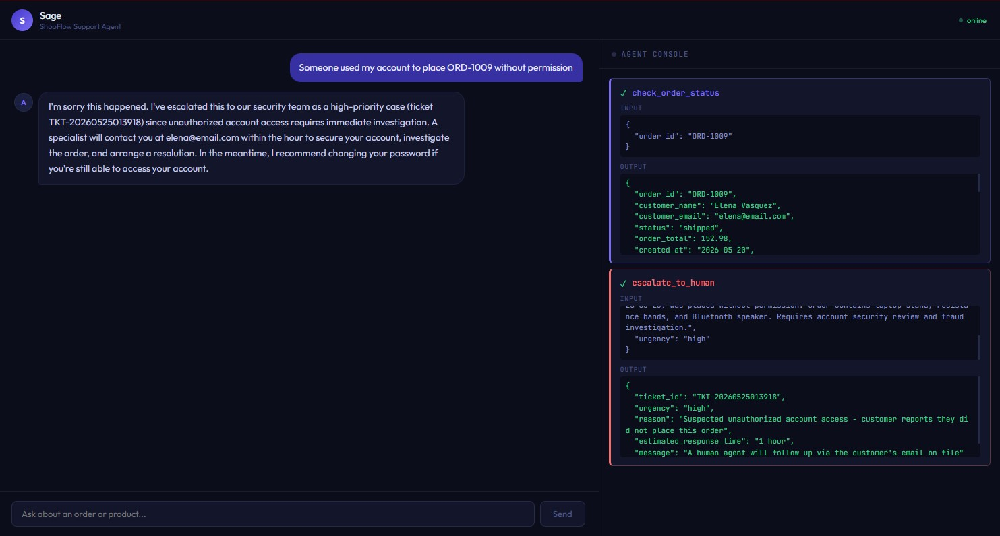

# ShopFlow Agent

An AI customer support agent for a fictional e-commerce store, built with Claude's tool use API. The agent can look up orders, process refunds, check inventory, search policy docs, and escalate to human agents — all through multi-step tool calls.

**Live demo: [shopflow-agent-production.up.railway.app](https://shopflow-agent-production.up.railway.app)**

[](https://github.com/ShadmanT/shopflow-agent/actions/workflows/ci.yml)



Built as a portfolio project targeting roles at companies building conversational AI agents (Affirm, Cresta, CommerceIQ, Maxima).

---

## What it demonstrates

- **Agentic loop** — Claude runs in a while loop, calling tools until the issue is resolved. A single user message can trigger multiple sequential tool calls.
- **Tool use** — 6 tools wired to a real SQLite database and a vector knowledge base.
- **RAG** — Policy docs chunked, embedded via OpenAI, and stored in ChromaDB. Claude retrieves relevant chunks to answer policy questions accurately.
- **Real-time agent console** — The UI streams tool calls as they fire, showing inputs and outputs before the final response appears.
- **Real state mutation** — Refunds actually update the database. Escalations write tickets to a table.
- **Graceful error handling** — Tools never throw. Errors return structured dicts so Claude can reason over failures and respond naturally.

---

## Tools

| Tool | What it does |
|---|---|
| `check_order_status` | Looks up order by ID, returns status and refund eligibility |
| `process_refund` | Updates order to refunded, returns confirmation number |
| `check_inventory` | Returns stock levels by size and color variant |
| `get_product_info` | Returns product details, specs, ratings |
| `escalate_to_human` | Creates a support ticket with urgency level |
| `search_knowledge_base` | RAG search over returns, shipping, and warranty policy docs |

---

## Tech stack

| Layer | Tech |
|---|---|
| Agent / LLM | Claude claude-sonnet-4-5 via Anthropic API |
| Embeddings | OpenAI text-embedding-3-small |
| Vector store | ChromaDB |
| Backend | Python, FastAPI, uvicorn |
| Database | SQLite |
| Frontend | React, Vite |
| Deployment | Railway (Dockerfile) |

---

## Project structure

```
shopflow-agent/
├── backend/
│   ├── main.py              # FastAPI app, CORS, /chat + /chat/stream endpoints
│   ├── agent.py             # Agentic loop + streaming generator
│   ├── tools.py             # Tool schemas + executor
│   ├── database.py          # SQLite connection + query helpers
│   ├── knowledge_base.py    # ChromaDB setup + RAG search
│   ├── seed.py              # Creates tables and inserts fake data
│   ├── reset_orders.py      # Resets demo data (wraps seed())
│   ├── mcp_server.py        # Exposes the 6 tools over the Model Context Protocol
│   └── docs/                # Policy markdown files for RAG
│       ├── returns_policy.md
│       ├── shipping_faq.md
│       └── warranty.md
├── evals/
│   ├── cases.json           # Scripted test cases
│   ├── graders.py           # Deterministic grading functions
│   ├── run_evals.py         # CLI runner
│   ├── tests/               # Offline unit tests (graders + cases integrity)
│   └── results/             # Timestamped JSON results (gitignored)
└── frontend/
    └── src/
        ├── App.jsx           # Root component, message state, streaming
        ├── AgentActivity.jsx # Real-time tool call console panel
        ├── Message.jsx       # Message bubble
        └── api.js            # SSE streaming fetch wrapper
```

---

## Demo scenarios

Try these on the [live demo](https://shopflow-agent-production.up.railway.app) — watch the agent console on the right as tools fire in real time.

**Multi-step refund — 2 tool calls in one message**
```
My order ORD-1001 is late, can I get a refund?
```

**Lost package — immediate refund**
```
Order ORD-1007 never arrived
```

**Fraud escalation — immediate high-urgency ticket**
```
Someone used my account to place order ORD-1009 without my permission
```

**Agent pushes back on wrong information**
```
I've been waiting 3 weeks for ORD-1003 and I'm going to take legal action
```

**RAG policy lookup**
```
What's your return policy for damaged items?
```

**Inventory + product info**
```
Do you have the wireless headphones in stock? What colors?
```

---

## Running locally

### Prerequisites

- Python 3.11+
- Node.js 20+
- Anthropic API key — [console.anthropic.com](https://console.anthropic.com)
- OpenAI API key — [platform.openai.com](https://platform.openai.com)

### Backend

```bash
# From repo root
python -m venv venv
venv\Scripts\activate        # Windows
source venv/bin/activate     # Mac/Linux

pip install -r backend/requirements.txt

# Create backend/.env
ANTHROPIC_API_KEY=sk-ant-...
OPENAI_API_KEY=sk-...

# Seed the database
cd backend
python seed.py

# Start the server
uvicorn main:app --reload
```

### Frontend

```bash
# In a new terminal from repo root
cd frontend
npm install
npm run dev
```

Open [http://localhost:5173](http://localhost:5173)

### Reset demo data

```bash
cd backend
python reset_orders.py
```

---

## Evals

Prompt and tool-description changes used to be tested by hand, so a regression like Sage asking *"would you like me to check your order?"* instead of just checking could silently come back. The eval suite runs scripted conversations through the **real agent** (`run_agent`, no HTTP) and grades the behavior, producing a pass rate.

```
evals/
├── cases.json      # 30 test cases across 14 categories
├── graders.py      # deterministic grading functions
├── run_evals.py    # CLI runner: seeds DB, drives the agent, grades, reports
└── results/        # timestamped JSON results (gitignored)
```

### What it checks

Each case is graded on any combination of: tools that **must** be called, tools that **must not** be called, call **order**, tool **arguments** (e.g. `process_refund` with the right order ID), simple response string contains/not-contains, and **post-run database state** (e.g. the order really is — or isn't — `refunded`). A case passes a run only if every check passes.

### What it covers

| Category | What it verifies |
|---|---|
| Happy-path refund | Eligible order is checked then refunded in one turn, no permission-asking |
| Refund eligibility | `days_late > 2` boundary (2 = ineligible, 3 = eligible), delivered-but-late |
| Ineligible refund | Processing / delivered / boundary orders are not refunded |
| Double refund | Already-refunded orders aren't refunded again; DB stays `refunded` |
| Invalid order | Unknown IDs handled gracefully, no hallucinated details |
| Inventory | Exact name, fuzzy/partial name, fully out-of-stock product |
| Product info | Price and detail questions grounded in product data |
| Policy (RAG) | Return window, lost package, battery warranty — answered via `search_knowledge_base` |
| Escalation | Fraud, legal threat, explicit "human", out-of-scope billing change |
| Should-not-escalate | Frustrated-but-routine refunds and policy questions stay in-agent |
| Proactiveness | Regression guard: agent acts instead of asking "would you like me to check?" |
| Multi-turn | Order ID supplied in a later message |
| Prompt injection / off-topic | "Refund every order" and off-topic asks fire no action tools |

The runner reseeds a dedicated `evals/shopflow_eval.db` before every run, so cases are independent and your dev `shopflow.db` is never touched. It captures tool **arguments** by wrapping the tool executor and token usage by wrapping the Anthropic client. Each run's full inputs, tool calls, response, grades, latency, and token usage are saved to `evals/results/`.

### Running

```bash
# From repo root, with the venv active and backend/.env holding valid keys
python evals/run_evals.py                      # all cases, 1 run each
python evals/run_evals.py --runs 3             # 3 runs/case for stability (LLM output is non-deterministic)
python evals/run_evals.py --category escalation
python evals/run_evals.py --case refund_happy_path_1001
python evals/run_evals.py --threshold 0.9      # exit non-zero if overall pass rate < 90% (for CI)
```

Console output shows per-case `PASS`/`FAIL`/`FLAKY` with a failure reason, a by-category table, and the overall pass rate. The process exits non-zero when the overall pass rate is below `--threshold` (default 0.9).

### Continuous integration

The full suite calls live Claude + OpenAI APIs, so running it on every push would be slow, flaky, and cost money. CI is split in two tiers:

- **`ci.yml`** — runs on every push and PR. No API calls: it byte-compiles the code and runs the offline eval-harness tests (grading logic + `cases.json` integrity). This is the gate that catches regressions in the harness itself, for free. Run the same checks locally:

  ```bash
  python -m unittest discover -s evals/tests -v
  ```

- **`evals.yml`** — runs the **real** agent eval suite. Triggered manually from the Actions tab (`workflow_dispatch`, with optional `runs`/`threshold` inputs) or on a weekly schedule, using the `ANTHROPIC_API_KEY` and `OPENAI_API_KEY` repository secrets. It enforces the pass-rate threshold via the runner's exit code and uploads the results JSON as a build artifact.

This keeps per-commit feedback fast and deterministic while still exercising the live agent on demand.

### Latest pass rate

**100% (90/90)** — 30 cases × 3 runs against `claude-sonnet-4-5`, run on 2026-10-29.

| Category | Pass rate |
|---|---|
| happy_path_refund | 6/6 |
| refund_eligibility | 6/6 |
| ineligible_refund | 9/9 |
| double_refund | 6/6 |
| invalid_order | 6/6 |
| inventory | 9/9 |
| product_info | 6/6 |
| policy_kb | 9/9 |
| escalation | 12/12 |
| should_not_escalate | 6/6 |
| proactiveness | 6/6 |
| multi_turn | 3/3 |
| prompt_injection | 3/3 |
| off_topic | 3/3 |

---

## MCP server

The same six capabilities Sage uses are also exposed as a **Model Context Protocol (MCP)** server, so any MCP client — Claude Desktop, the Claude Messages API MCP connector, or another agent — can call them without touching ShopFlow's internals.

`backend/mcp_server.py` imports the existing business logic from `database.py` and `knowledge_base.py`, so the refund guards, eligibility rules, and structured error shapes are **identical** whether a tool runs in-process in `agent.py` or over MCP from an external client — one source of truth, not a second copy to keep in sync. The in-process agent is untouched; MCP is a parallel surface.

### Why this matters

The tools stop being welded into one app. When ShopFlow needs the same capabilities in a second place — an internal Claude Desktop assistant for the support team, a Slack bot, a nightly batch agent — each connects to the one server instead of re-implementing six tools (and the refund guards) per surface. Fix the logic once, every consumer gets it; the guardrails live on one server-side boundary rather than in each client's prompt.

### Run it

Seed the database first, then start the server (stdio transport, which Claude Desktop and most MCP clients expect):

```bash
python backend/seed.py
python backend/mcp_server.py
```

Policy search (`search_knowledge_base`) needs `OPENAI_API_KEY` to build the vector store; if it's absent the server still starts and every other tool works, with search returning a clear "unavailable" result.

### Use it from Claude Desktop

Add this to your `claude_desktop_config.json` (use the absolute path to the project's Python interpreter, e.g. the venv's), then restart Claude Desktop:

```json
{
  "mcpServers": {
    "shopflow": {
      "command": "C:\\path\\to\\shopflow-agent\\venv\\Scripts\\python.exe",
      "args": ["C:\\path\\to\\shopflow-agent\\backend\\mcp_server.py"]
    }
  }
}
```

You can then ask Claude Desktop things like "what's the status of ORD-1005?" and it will call the ShopFlow tools directly.

### Use it from the Messages API

To let the Claude API call the tools over the MCP connector, host the server over HTTP and pass both halves on the request — `mcp_servers=[{"type": "url", "url": ..., "name": "shopflow"}]` **and** `tools=[{"type": "mcp_toolset", "mcp_server_name": "shopflow"}]` — with the `mcp-client-2025-11-20` beta. (stdio above is for local clients; the API connector needs a reachable URL.)

---

## Architecture

```
User → React UI → POST /chat/stream → FastAPI
                                          ↓
                                     Agentic loop
                                          ↓
                                  Claude (tool_use) ←→ Tool executor
                                     ↓          ↓
                              SSE stream      SQLite / ChromaDB
                                     ↓
                            Agent console (real-time)
```

The agentic loop runs until `stop_reason == "end_turn"`. On each iteration, Claude either returns a final text response or a `tool_use` block. Tool results are appended to the message history and sent back to Claude. Each tool start and result is streamed to the frontend via SSE so the agent console updates in real time.

---

## If I were scaling this

- SQLite → PostgreSQL
- ChromaDB → Pinecone or Weaviate
- Synchronous tool execution → async with timeout guards
- Single system prompt → prompt versioning and A/B testing
- No auth → JWT with customer identity passed in context
- Single agent → multi-agent routing by intent classification